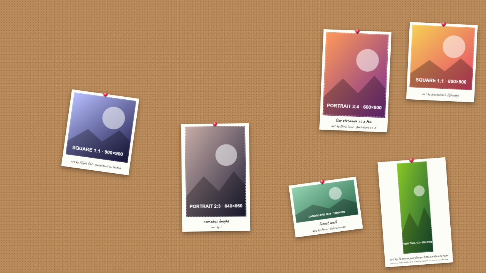
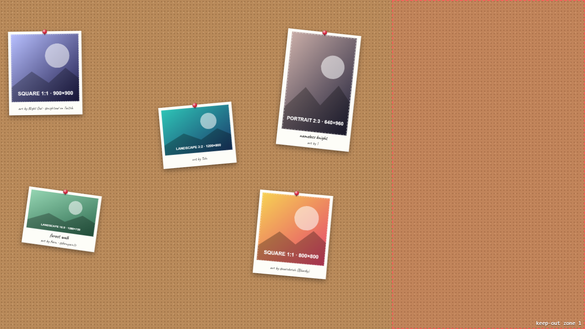

# Polaroid Fanart Gallery

StreamElements overlay widget that shows fan art as rotating polaroids, each crediting its
artist. Polaroids land in random spots with an overlap limit and stay clear of keep-out
zones such as the chat box.



Screenshot from the local preview with the sample art. The corkboard is the preview
background; on stream the widget is transparent.

Version 1.1.0. Design spec: [polaroid-fanart-widget-spec.md](polaroid-fanart-widget-spec.md).

## Requirements

- **Stream.** A StreamElements overlay, added to OBS as a browser source.
- **Local preview.** Any static file server, e.g. Python's `http.server`. No build step.

## Install

1. In StreamElements, open **Streaming tools → Overlays** and open or create an overlay.
2. **+ (Add widget) → Static / Custom → Custom widget**, then **Open editor**.
3. Replace the contents of each editor tab with the matching file:

   | Editor tab | File |
   |------------|------|
   | HTML   | [widget/widget.html](widget/widget.html) |
   | CSS    | [widget/widget.css](widget/widget.css) |
   | JS     | [widget/widget.js](widget/widget.js) |
   | FIELDS | [widget/fields.json](widget/fields.json) |

4. **Done**, then **Save** the overlay.

Drag and resize the widget box to set where the polaroids can go.

## Adding art

The settings panel has 24 slots, **Artwork 01** to **Artwork 24**. In a slot, upload an
**Image** (PNG or JPG, under 30 MB; 1000–2000 px on the long side is enough), then fill in
**Artist name**, **Handle** (shown as typed, e.g. `@name on X`) and an optional **Caption**.
Untick **Show this artwork** to hide a slot without clearing it. Empty slots are skipped.

A slot with no name or handle shows `art by ?` on stream.

## Layout

- **1 polaroid** — centered in the box, or a random spot with **Single polaroid: land in a
  random spot**.
- **2–6 polaroids** — each new one lands in a random free spot. At 0% max overlap they
  never cover each other and shrink to fit; above 0% they stay full size and may cover up
  to that share of each other, shrinking only if needed.

### Keep-out zones

Up to 3 rectangles where polaroids won't land, set in the **Keep-out zones** section as
left / top / width / height in % of the widget box. Example, a chat column on the right
third: `left 67, top 0, width 33, height 100`.

Zones show as red dashed outlines in the StreamElements editor and with the debug panel on,
never on stream.



**How much of a polaroid may cover a zone (%)** sets the limit (0 = never touch a zone). It
is measured on the tilted outline at the tallest photo size, so polaroids end up a bit
clearer than the number. Polaroids shrink to fit around zones; a centered single polaroid
moves to the nearest clear spot. If nothing fits, the widget falls back to a grid that
ignores zones and the debug panel shows a warning.

## Settings

| Setting | Description |
|---------|-------------|
| Polaroids on screen | 1 = single polaroid; 2–6 = scattered wall, one swapped per rotation |
| Single polaroid: land in a random spot | Random spot instead of the center (1 polaroid only) |
| Max overlap between polaroids (%) | 0 = no overlap, shrink to fit; 100 = no limit |
| Polaroid width (px) | Text, pin and frame scale with it |
| Max photo height (px) | Taller art gets frame-colored side bars instead of cropping |
| Seconds per artwork | Rotation interval |
| Transition length (seconds) | Drop-in and fall-away animation length |
| Order | Shuffle (each piece once per round) or slot order |
| Which polaroid changes | Oldest first, or random (never the same spot twice in a row) |
| Max tilt (degrees) | 0 = straight |
| Frame color | Polaroid paper color |
| Caption font | Any Google Font |
| Caption text color | Caption and credit color |
| Show artist handle | Off = name only |
| Text before artist name | Defaults to `art by`; can be changed or cleared |
| Pin style | Pushpin, tape, or none |
| Pushpin color | Pushpin style only |
| Shadow strength | Drop shadow strength |
| Keep-out zones | Up to 3 zones plus the zone overlap limit |
| Show debug panel | Troubleshooting box; keep off on stream |

## Local preview

```bash
py -m http.server 8000
```

Then open `http://localhost:8000/preview/preview.html`. The preview fakes the
StreamElements runtime: the side panel edits the fields and reloads the widget, **Next**
forces a rotation, and fields can be set from the URL:

```
preview.html?polaroidCount=6&pinStyle=tape
```

Sample data in [preview/sample-fielddata.json](preview/sample-fielddata.json) includes a
hidden slot (09) and a broken image URL (10) on purpose. `file://` won't work because the
browser blocks the JSON fetch.

## Troubleshooting

- **Stream not updating** — in OBS, open the browser source's properties and click
  **Refresh cache of current page**.
- **Anything else** — turn on **Show debug panel**. It lists active slots, recent events
  (e.g. failed image loads) and warnings. The overlay has no `console`.

## Adding slots

Copy the five `slot24_*` entries in [widget/fields.json](widget/fields.json), rename `24`
to `25` in the keys and in the group name (`"Artwork 25"`), validate the JSON, and paste
the file into the FIELDS tab again. Uploads are kept. Slots are discovered by key, up to 99.

## Project structure

- `widget/` — the four files pasted into StreamElements (HTML, CSS, JS, fields)
- `preview/` — local harness that fakes the StreamElements runtime, with sample data and art
- `docs/screenshots/` — README screenshots
- `polaroid-fanart-widget-spec.md` — design spec

## Changelog

The version is shown on the first line of the debug panel and in `WIDGET_VERSION` in
[widget/widget.js](widget/widget.js).

- **1.1.0** — keep-out zones. Re-paste the JS, CSS and FIELDS tabs; artwork is kept.
- **1.0.0** — first release.
